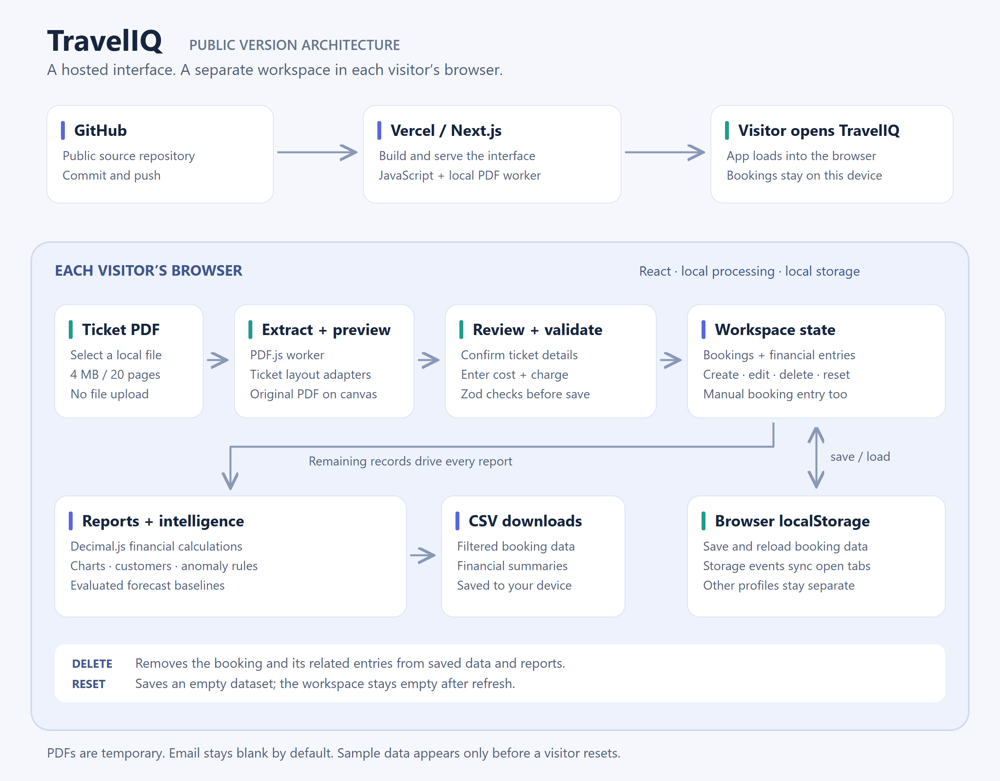

# TravelIQ — Public version

A public travel-agency dashboard with browser-local bookings, ticket PDF import, financial tracking, charts, customer insights and evaluated forecasting.

This package contains **only the public version**. There is no sign-in, account management, cloud database, private API, Supabase integration or private deployment configuration. Every visitor works with their own browser's saved data.

## Architecture



GitHub holds the source and Vercel serves the Next.js interface. Ticket extraction, human review, booking storage and analytics run in the visitor's browser. Saved booking data feeds the dashboard; deleting a booking removes its contribution to every report, and Reset Demo persists an empty workspace. PDFs stay temporary on the device.

The [SVG version](docs/images/architecture.svg) stays sharp at any size.

## Changes in this release

### Connecting flights show the final destination

A ticket with `TRV → BLR` and `BLR → MAA` now appears as **TRV → MAA, via BLR** in the booking summary. Every leg remains available in the booking details. Upcoming journeys, destination filters, destination charts, route analysis and CSV exports use the complete outward route. Existing saved bookings update automatically; no re-import is needed. Return itineraries keep their outward destination in the summary and retain return legs in the details.

### 1. Ticket PDF import fixed

- Added support for the IndiGo itinerary layout with **PNR / Booking Ref**, **Passenger Information** and airport/time columns.
- Reads multiple passengers, the booking reference, airline, flight number, airports, departure and arrival times.
- Customer name defaults to **Passenger 1**. A clearly labelled customer/passenger contact number is filled when present. If the ticket has no number, the field stays blank for manual entry.
- **Email stays blank and optional**, even when the PDF contains an email address.
- Agency cost and customer charge always require manual entry. Ticket payment status does not create a payment entry.
- The provided ticket was checked privately; original customer PDFs and their personal details are excluded from this repository.

### 2. Delete replaces Archive

- Open a booking and select **Delete**, then confirm.
- The booking, passengers, flight details and associated financial entries are removed from this browser's saved data, including entries with an outstanding balance.
- Overview totals, financials, customer lists, graphs, analytics, forecasts and exports update from the remaining records.
- Delete can be cancelled before confirmation. Once confirmed, it cannot be undone.
- Records archived by the earlier version are excluded from reports. Find them under **Settings → Previously archived bookings** and open them to delete them permanently.

### 3. Reset Demo starts completely empty

- **Reset demo** removes both the sample dataset and every booking or financial entry added in this browser.
- The empty state remains after refreshing or reopening the app; sample data is not restored automatically after a reset.
- Other open tabs in the same browser update too. Other visitors and browser profiles are unaffected.
- A first-time visitor still receives fictional sample bookings for exploring the dashboard. Reset clears all of them.

## Run locally

Use Node.js 24 and npm. From the extracted project folder:

```sh
npm ci
npm run dev
```

Open **http://localhost:3000**. On Windows, `start-local.cmd` performs the same setup and starts the app. Installing dependencies requires internet access. No environment file, API key, database or deployment account is needed.

For a production build:

```sh
npm run build
npm start
```

The separate offline installation for family use is deferred; this ZIP is the public GitHub source project.

## Upload to GitHub

Create an empty repository and upload the contents of this project folder, or use Git:

```sh
git init -b main
git add .
git commit -m "Add TravelIQ public dashboard and ticket import fixes"
git remote add origin YOUR_REPOSITORY_URL
git push -u origin main
```

The included `.gitignore` excludes installed dependencies, build output, local environment files and test artifacts. The ZIP contains no customer PDFs or live booking records. Uploading source to GitHub does not itself publish a running website.

## Data and privacy

Booking records are stored in this browser's `localStorage`, under `traveliq-demo-v1`. The same browser profile and site address share a workspace; this is not account-based storage. Clearing site data removes saved records. A different device, browser profile, hostname or port has separate storage. Keep the same address when reopening your workspace.

PDF parsing and preview happen on your device. PDFs are not uploaded or retained after the review closes. A customer can have multiple bookings; deleting one preserves the others. Reset affects booking data while keeping your theme preference.

## Features

- Bookings, multiple passengers and flight segments; search, filters, sorting and CSV export.
- Payments, refunds and explained charge/cost adjustments with decimal-safe arithmetic.
- Revenue, cost, gross profit, outstanding balances and customer credit.
- Customer groups, route/airline analysis, rule-based anomaly flags and a what-if simulator.
- Forecasting with chronological validation and holdout evaluation. Insufficient history produces an explanatory empty state.
- Responsive light/dark interface and six fictional PDF examples in Documents.

The demo reference date is **12 October 2026** for reproducible sample charts. Flight times are the local times printed on tickets. All amounts use INR. Review every extracted field before saving. Scanned/image-only or encrypted PDFs are unsupported; import limits are 4 MB and 20 pages.

## Verification

```sh
npm run lint
npm run typecheck
npm test
npm run pdf:evaluate
npm run build
npm run test:e2e
```

Browser tests use Chrome. They cover the import/save/payment/delete flow, empty reset after reload, same-browser tab updates, separate-visitor isolation, old archived records, responsive navigation, themes and the absence of private endpoints. PDF regression evaluation checks **78/78 expected fields across six fictional documents**. The supplied real ticket is not included in automated tests or the package.

Verified on 13 October 2026: **30 unit tests and 6 browser workflows passed**. Lint, type checking and the production build also passed. The supplied layover ticket was separately verified in the public browser importer: its summary and CSV use the final destination while both original flight legs remain available. The earlier PDF evaluation passed 78/78 fields and the Python evaluation passed 5 tests; this update does not change those extraction or forecast algorithms.

See [PDF extraction](docs/PDF_EXTRACTION.md) and [analytics methodology](docs/DATA_SCIENCE.md) for implementation details and limits. The optional `data-science/` folder contains the separate Python evaluation and tests; it is not needed to run the website.
