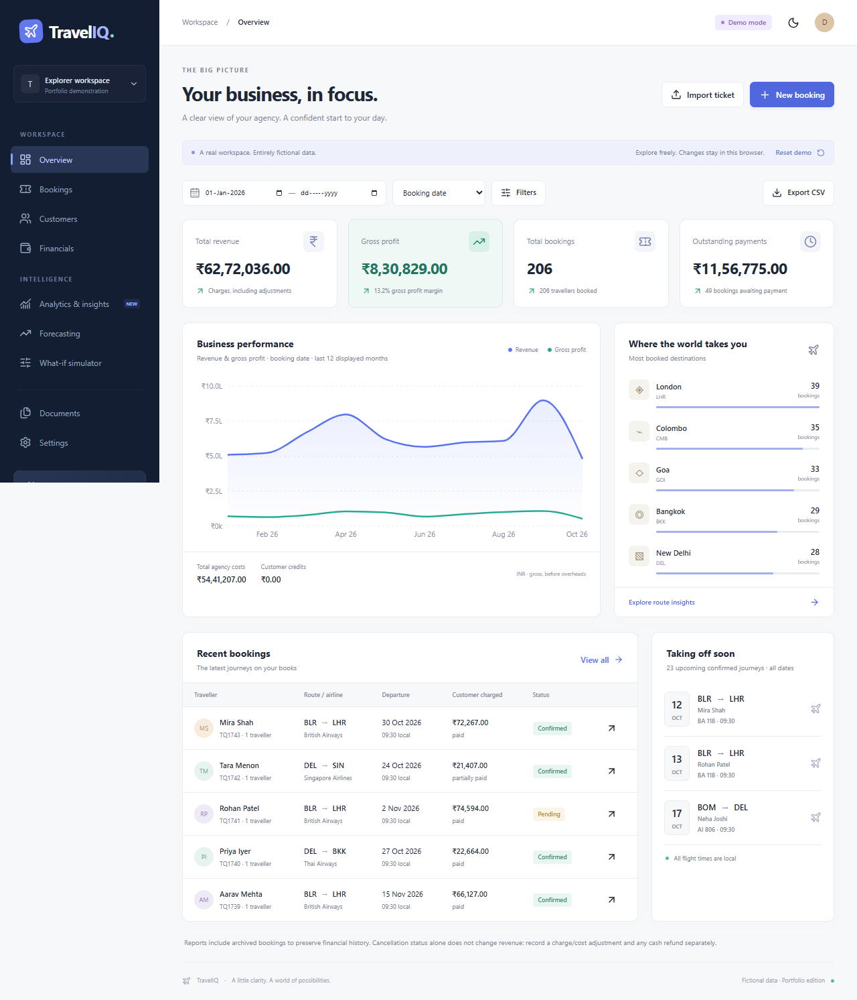
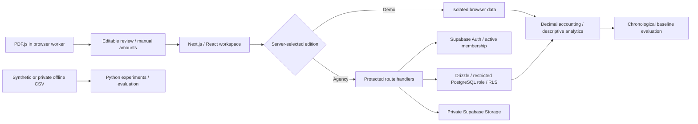

# TravelIQ

**A travel agency workspace that turns bookings into business intelligence.**

TravelIQ brings ticket review, customer history, decimal-safe accounting and explainable analytics into one Next.js application. It is designed as a studyable AI & Data Science portfolio project with a separate private agency mode.



**Deployment status:** built and tested locally. GitHub, Vercel and Supabase account connection is intentionally deferred. There is no live demo URL yet; add the public Vercel URL here after deployment. No real agency records or original customer tickets are included in this repository.

## The problem

Small agencies often re-enter ticket details into spreadsheets, mix ticket fares with actual agency costs, and lack a consistent view of receivables and profitability. TravelIQ requires human verification of extracted ticket details and **always requires manual agency cost and customer charge entry**. It separates commercial amounts from cash movements so a refund is not silently treated as a price change.

## Two isolated editions

|                | TravelIQ Demo                        | TravelIQ Agency                              |
| -------------- | ------------------------------------ | -------------------------------------------- |
| Access         | Public; no login                     | Invited/admin-created accounts               |
| Data           | 743 deterministic fictional bookings | PostgreSQL records scoped to an agency       |
| Persistence    | Resettable browser local storage     | Drizzle + PostgreSQL                         |
| PDF processing | On the visitor's device              | On the staff member's device                 |
| PDF retention  | Temporary preview only               | Optional private Supabase Storage            |
| Credentials    | None                                 | Server-side environment variables            |
| Deployment     | Dedicated Vercel project             | Separate Vercel project and Supabase project |

The demo deliberately has **no remote database or storage service**. This is stronger isolation than sharing a database with a demo flag. The build and runtime refuse demo operation if agency credentials are present. Do not enter real customer details in the public demo, including its browser storage.

## What works

- Booking creation, editing, archiving, search, date/status/airline/destination filters, sorting, CSV export and duplicate warnings. Internal UUIDs are the identifiers; PNRs are not unique.
- Multiple passengers and flight segments, local departure/arrival times, original PDF preview and explicit extraction verification. Customer name defaults to Passenger 1, customer/passenger contact is prefilled, and email stays blank and optional.
- Three modular text parser families: labelled tickets, agency flight tables and agency flight cards. Five fictional PDFs and expected field results are included.
- Customer profiles, complete booking histories, spending, frequency, gross profit and last booking dates.
- Immutable original charges/costs; separate payment, refund and signed adjustment entries; outstanding amounts and customer credits; booking-date/departure-date reporting and payment-date cash charts.
- Live dashboard calculations, RFM-style customer groups, route/airline profitability, margin distribution, revenue concentration, robust outlier rules and scenario simulation.
- Monthly baseline forecasting (18 complete months, 12 active months and 36 bookings required) with chronological model selection, separate holdout evaluation, MAE/RMSE/WAPE and honest short-history withholding.
- Agency route authorization, database row-level isolation, admin/staff restrictions, origin checks, rate limiting, audit records and short-lived document download links.
- Responsive navigation, light/dark themes, accessible Radix dialogs, labelled forms, loading/error/empty states and notifications.

CSV files open in Excel. XLSX output is not implemented. Advanced ARIMA, clustering and Isolation Forest are not claimed; the implemented methods are intentionally explainable and suitable for the available sample size.

## Run the demo locally

Install Node.js 24 LTS (or a compatible Node version >=22.13) and run:

```sh
npm ci
npm run dev
```

Open [localhost:3000](http://localhost:3000). No environment file is needed for the demo. If you use `.env.local`, copy `.env.demo.example` and ensure it contains no agency credentials. The fictional reference date is **12 October 2026**; this makes screenshots and evaluations reproducible.

Windows users can also run `start-local.cmd` after installing Node.js. Keep its terminal open while using the application.

```sh
npm run lint
npm run typecheck
npm test
npm run pdf:evaluate
npm run build
npm run start
```

For browser tests, install Google Chrome (the configured Playwright channel) and run `npm run test:e2e`. The test configuration can start the development server automatically. To use an already-running server, set `PLAYWRIGHT_EXTERNAL_SERVER=1`.

## Architecture



The application uses Next.js App Router, TypeScript, React, Tailwind CSS, Radix dialog primitives, Lucide, Recharts, Zod, Decimal.js, Drizzle and postgres.js. Supabase's maintained server SDK handles authentication. It uses Node route handlers compatible with Vercel; Python runs **offline**, never as a persistent Vercel subprocess. The UI uses lightweight local components in the shadcn style rather than installing the full shadcn generator.

```text
src/
  app/                  Pages, error/loading states and protected API routes
  components/           Workspace, forms, charts and intelligence views
  db/schema.ts          Drizzle model
  db/generated/         Initial migration + explicit constraints/RLS/grants
  db/repository.ts       Transactional, agency-scoped operations
  lib/finance.ts        Exact monetary calculations
  lib/analytics.ts      Aggregation, segmentation, anomaly rules, scenarios
  lib/forecast.ts       Rolling-origin baseline comparison
  lib/pdf/              Browser extraction and layout adapters
scripts/                Migrations, onboarding, sample generation, evaluations
public/samples/         Fictional PDFs and expected fields only
public/reports/         Measured synthetic evaluation results only
data-science/           Offline Python evaluation and reproducible input
tests/                  Unit, PostgreSQL-engine integration and browser tests
docs/                   Deployment, methodology, security and screenshots
.github/workflows/      Continuous integration
```

## Database and agency setup

Follow [the deployment guide](docs/DEPLOYMENT.md) for Supabase configuration, the restricted database role, initial administrator onboarding and two Vercel projects. [Architecture and accounting](docs/ARCHITECTURE.md) explains the normalized tables, isolation and reporting definitions.

The database schema contains agencies, memberships, customers, bookings, passengers, flight segments, financial records, payments, refunds, adjustments, documents, audit logs and rate-limit counters. Composite foreign keys prevent attaching another agency's customer or booking to a record. `numeric(14,2)` stores money; money enters the application as decimal strings.

## Measured data science results

These results were **actually calculated on synthetic data**, not on business history. They are not evidence of real-world forecast accuracy. There are 36 complete monthly observations, six rolling validation origins, and three final rolling holdout origins. The incomplete October 2026 month is excluded.

| Target       | Selected method |   Holdout MAE |  Holdout RMSE | Holdout WAPE |
| ------------ | --------------- | ------------: | ------------: | -----------: |
| Bookings     | Naive           | 3.00 bookings | 3.42 bookings |       14.29% |
| Revenue      | Seasonal naive  |   ₹178,437.33 |   ₹215,375.27 |       25.42% |
| Gross profit | Seasonal naive  |    ₹26,039.00 |    ₹30,258.53 |       26.54% |

These relatively large errors are shown transparently. No interval is displayed because the holdout is too small to establish calibrated coverage. Browser and Python implementations produce the same measured scores. See [methodology and interview notes](docs/DATA_SCIENCE.md), [browser results](public/reports/forecast-evaluation.json) and [Python results](data-science/reports/synthetic-evaluation.json).

```sh
npx tsx scripts/export-synthetic.ts
python -m pip install -r data-science/requirements.txt
python data-science/evaluate.py
python -m unittest discover -s data-science -p test_evaluate.py
```

## PDF extraction evaluation

`npm run pdf:evaluate` extracts actual PDF bytes using PDF.js and compares field values against checked-in expectations. The five fictional fixtures scored **64/64 exact field matches**. This is a small regression corpus, not a claim of universal ticket extraction accuracy. Missing/ambiguous values remain blank. The three provided ticket layouts were also checked locally; their source files and personal data are not included.

Parsers never emit `agencyCost` or `customerCharged`. The review form validates manual money fields and requires explicit confirmation for an imported PDF before saving. Unknown layouts, scanned/image PDFs, encrypted documents and ambiguous dates may need manual entry. See [PDF methodology](docs/PDF_EXTRACTION.md).

## Verification and limits

See [the verification record](docs/VERIFICATION.md) for executed checks and unverified external integrations. Automated coverage includes decimal accounting, validation, model evaluation, PDF layouts, real PostgreSQL-engine operations using PGlite, authentication boundaries, agency isolation, duplicate checks and browser workflows.

**Before real agency use:** connect Supabase, complete its configuration, test login/logout/recovery/invitations and private storage in the deployed environment, and exercise backup restoration. Those live managed-service checks could not be performed without your accounts. This repository is not a certification that an unconfigured deployment is production-ready.

Limitations include no OCR, no multicurrency conversion, no operating-expense ledger, no statutory financial statements, no automatic time-zone inference, and no remote demo persistence. The agency UI currently loads records in 250-record batches; for larger agencies, move full-history aggregations and analytics to database queries/jobs. Original financial entries are immutable; correct mistakes with documented adjustments or compensating cash entries. No clinical, legal or accounting compliance claim is made.

## GitHub and Vercel

Create an empty GitHub repository, publish this source with your Git identity, then import it twice into Vercel. Keep the demo environment credential-free and production previews isolated from the live agency database. Never add original tickets, real customer exports, `.env.local`, or provider secrets to Git. See [the step-by-step guide](docs/DEPLOYMENT.md).

## Next improvements

Broader airline fixtures, user-validated time-zone support, server-side analytics for larger histories, stronger CSP nonces, point-in-time forecasting snapshots, longer holdout studies and calibrated intervals, optional background malware scanning, and an administrator account-management UI.
