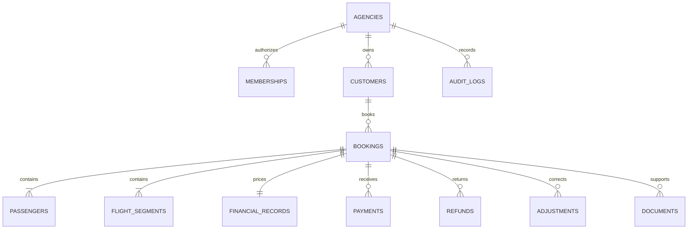

# Architecture and accounting

## Normalized records

Every business table stores `agency_id`. A membership links a Supabase authentication UUID to one agency, role and active flag; clients cannot choose an agency ID. UUID booking IDs are primary keys; PNR is a searchable, non-unique attribute. Customer matching uses normalized name plus phone within the agency. This reduces duplicates without merging unrelated people sharing a name or a family phone number alone. Editing a customer identity may create another profile; an administrator should review mistaken identities rather than blindly merge them.

Passenger and segment position preserves itinerary order. Flight timestamps are explicit local wall-time strings, not falsely converted to UTC. A return flight is another segment. Airport codes are entered/verified three-letter values. Currency is explicit INR and constrained in this release; multicurrency requires FX and reporting policy before enabling another code.

Money is PostgreSQL `numeric(14,2)`, serialized as strings. Zod accepts at most nine integer digits and two fractional digits on input. Decimal.js performs all arithmetic. Conversion to JavaScript numbers occurs only for chart rendering and statistical models; it does not write financial values.

## Exact financial definitions

- Adjusted revenue = original customer charge + signed charge adjustments.
- Adjusted cost = original agency cost + signed cost adjustments.
- Gross profit = adjusted revenue − adjusted cost.
- Gross margin = gross profit / adjusted revenue × 100; defined as 0 for zero revenue.
- Net cash = payments received − cash refunds.
- Balance = adjusted revenue − net cash.
- Outstanding = max(balance, 0); customer credit = max(−balance, 0).

Original amounts, payment/refund/adjustment rows and audit rows cannot be updated/deleted by the runtime database role. Refunds cannot exceed net receipts, and new payments cannot exceed outstanding balance. Adjustments cannot make charges/costs negative. Booking-row locks serialize concurrent cash entries; optimistic versions reject stale booking edits. Archive requires a settled balance, retains all transactions, and remains included in financial reports.

**Cancellation example:** a ₹10,000 charge with ₹8,000 agency cost, fully paid, is cancelled with ₹1,000 retained revenue and ₹500 retained cost. Record an adjustment of −₹9,000 charge and −₹7,500 cost, then a ₹9,000 cash refund. Revenue is ₹1,000, gross profit ₹500 and outstanding zero. A status change alone does nothing to amounts.

## Date bases

Booking and departure views allocate the _current adjusted booking totals_ to booking date or the first segment's departure date. They are operational cohort reports. They do not recreate a previously closed accounting period. The cash chart groups the selected cohort's payments/refunds by their own transaction date. Transaction CSV retains all adjustment dates and notes. Forecasting uses complete booking-date months and excludes the current incomplete month.

## Security boundaries

`APP_MODE` is read on the server. Demo mode never calls a business database or a storage service. Agency endpoints verify the Supabase user with `getUser()`, read an active server-owned membership, and check roles. User metadata is never trusted for agency or role assignment. Next's proxy refreshes cookies only; it is not the authorization layer.

Every repository operation is transactional and explicitly agency-scoped. It sets transaction-local PostgreSQL context for RLS, and composite foreign keys reinforce tenant consistency. The runtime role must be `traveliq_app`, have no BYPASSRLS/superuser capability, and have the narrow grants in migration 0001. Never give this runtime role the migration/owner password. Business tables expose no public API grants; RLS grants apply only to the application role. Supabase's browser client cannot query these tables.

JSON requests are capped; mutation origins must exactly match APP_URL. PDFs are checked for extension, MIME, signature and size. Browser parsing limits pages/time/text length. Private uploads use server-generated paths; document IDs are authorized before generating 60-second attachment download links. No external AI service processes tickets.

The audit table records actor, agency, action, record UUID, timestamp and limited financial/version metadata. Logs intentionally omit passenger/contact details and ticket contents. Changes to members are performed by a trusted administrator through Supabase/CLI and should also be recorded in the provider's administrator audit trail.
